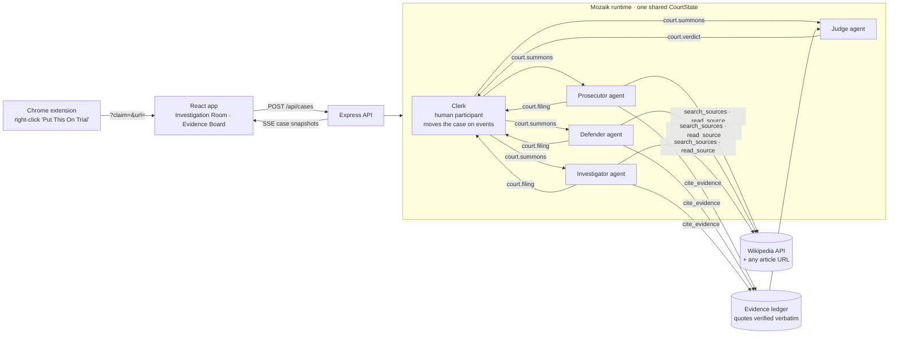

# The Ground Truth — Election Desk 2026

**Don't just read the news. Cross-examine it.**

The Ground Truth is a civic-technology tool for examining election claims, competing media narratives and verifiable evidence. It was built in Novi Sad, Serbia, at the JigJoy Mozaik hackathon (30–31 October 2026), during a ten-day stretch with three elections:

| Country | Election | Date | Information-integrity context (quoted from the source) |
|---|---|---|---|
| **Serbia** | Early parliamentary | 25 Oct 2026 | Observers found that media bias and online manipulation *"hampered voters’ ability to obtain impartial and reliable information."* ([OSCE/ODIHR preliminary findings](https://odihr.osce.org/node/666908)) |
| **United States** | Midterm federal general | 3 Nov 2026 | *"Tuesday, November 3, 2026, is the next regularly scheduled federal General Election date."* ([FEC](https://www.fec.gov/introduction-campaign-finance/election-results-and-voting-information/)) |
| **South Africa** | Local government | 4 Nov 2026 | The Electoral Commission's new Disinformation Code requires parties to *"Label AI-generated (“synthetic”) content clearly before distributing it."* ([gov.za](https://www.gov.za/news/media-statements/electoral-commission-introduces-new-disinformation-code-ahead-2026-local)) |

Serbia's vote followed a protest movement that began in Novi Sad, the city where this project was built. According to [Al Jazeera](https://www.aljazeera.com/features/2026/9/28/serbias-snap-election-can-vucic-outmanoeuvre-the-student-revolt), *"16 people were killed in 2024 when a concrete canopy collapsed at a railway station"* and *"Student protesters blamed the disaster on government negligence and alleged corruption."*

## Why this exists

Most election misinformation is not invented from nothing. It is a real sentence with its second half removed, an institution given a power it doesn't have, or a rule described as broader than it is. Fact-checks arrive late, while framing travels fast. The Ground Truth lets anyone put a claim on trial in minutes, and shows:

- **Provenance:** every exhibit is a verbatim quotation, checked word for word on the server, linked to its source, publisher and date.
- **Uncertainty:** verdicts state what remains unknown, and "insufficient evidence" is an acceptable answer.
- **Fact vs framing:** challenges are tagged as *factual* (is it true?) or *framing* (what was selected, emphasised or left out). The Judge lists framing problems separately from factual findings.
- **No consensus-as-proof:** agreement between agents never counts as evidence.

## The 3D newsroom (default)

The newsroom is a real-time 3D room built with **React Three Fiber, Drei and three.js** (`web/src/room3d/`):

- **Assets:** CC0 furniture models, PBR textures (herringbone parquet, plaster, oak veneer) and a daylight city HDRI from [Poly Haven](https://polyhaven.com). They are listed in `web/public/assets/3d/CREDITS.md`, and `python3 scripts/fetch-assets.py` downloads them again if needed.
- **Light:** the sun comes through the steel-framed window wall and throws real window shadows across the floor and the evidence board.
- **Camera:** it travels between the room, the election table, each workstation and the evidence wall, and stays inside the room. Drag to look around; `Esc` returns to the overview.
- **Everything readable is drawn from case data onto textures:** monitor screens (live Mozaik activity, or the agent's position), clippings with each source's own photo (served through a guarded same-origin proxy, because WebGL needs CORS-clean pixels), handwritten lead cards, the ruling, the map and the newspaper. Strings run from each exhibit to the claim, coloured by bearing. Close reading happens in the document sheets, not in tiny 3D text.
- **Opening:** a broadcast cold open. The camera starts inside the newsroom, tight on the live election board (the three elections and their countdowns), framed by a letterbox with a LIVE bug and the real time, and a lower third with the title and two actions. "Walk into the newsroom" (or Enter) retracts the frame while the camera dollies back into the room; "Open the Serbia investigation now" starts the flagship case live.
- **Election desk identity:** a wall sign reading "The Ground Truth | ELECTION DESK"; a live election screen (the three elections, with countdowns, and what the desk is investigating now); a scrolling ticker of sourced dossier facts and live case events; a hanging sign over each desk showing its live status; and framed election posters.
- **People:** a reporter at each agent desk (typing while that agent's loop runs, on the phone while chasing a lead, reading when filed), the editor-in-chief at the table who moves to the wall to rule, and a researcher at the shelves. They are sculptural, faceless figures in the style of architectural visualisation, used because no realistic, licensed character models were available without an account.
- **Agents are present through their workstations:** each screen streams that agent's activity, its arm lamp lights while its loop runs, its chair swivels, its paper tray fills with every verified quote, speech bubbles show challenges, rebuttals and leads, and verified clippings fly from the desk to the wall. Large monitors make the three active desks the most prominent objects in the room.
- **Accessibility and tests:** a station dock and a row of exhibit chips give keyboard and screen-reader access to what is otherwise canvas-only.

**Fallbacks:** `?view=2d` (or a link in the HUD) opens the illustrated 2D room, which is also used automatically when WebGL is unavailable. `?view=text` opens a plain text view of any case. The backend, the API and the Chrome extension are unchanged.

## The illustrated 2D newsroom (fallback)

You are the editor of a sunlit election newsroom. Each Mozaik agent is an illustrated reporter, labelled as an AI agent. You watch them work, and you make the calls that steer the investigation. There are no pages. The camera moves between stations in one room (see [`DESIGN.md`](DESIGN.md)):

| Station | Where | What you do |
|---|---|---|
| **Election table** | The oak table, with a map laid flat | Choose a brass pin (Serbia, United States, South Africa) and the camera moves in on that country's dossier: date, context quoted verbatim from primary sources, the sources, and a test claim you can put on trial |
| **Case desk** | The manila folder | Open your own case on a typed intake sheet, or read the open case's file |
| **The investigators** | Three workstations | Each monitor shows that agent's live Mozaik activity, its banker's lamp is lit only while its loop is running, and its paper tray grows with every quote it gets verified. Click a monitor to read the agent's file: positions by round, reasoning (labelled *not evidence*), challenges and its research trail |
| **Evidence wall** | The cork board at the back | Exhibits fly in from the desk that entered them. Strings are coloured by bearing (red only for contradictions), disagreements arc between advocate tags, sources and positions sit on the wings, and the ruling is pinned when it's delivered. Open any document, stamp the ruling, save it, or reopen it with an objection |

### Investigations that evolve, with you as editor

A case is no longer one pass and a verdict:

1. **Investigation:** three reporters work concurrently, citing verified quotes and raising **leads**, questions worth separate research.
2. **Your decision:** assign leads to specific desks (up to three, in any combination), write your own lead, or skip ahead.
3. **Leads:** assigned desks research **concurrently**, often on leads another desk raised, and report back on index cards.
4. **Cross-examination:** all three reporters challenge one another, each challenge tagged factual or framing.
5. **Rebuttal:** only the challenged reporters are summoned, in parallel, to answer or concede.
6. **Your decision:** send the case to the judge, or send someone back out for more reporting.
7. **Verdict:** the editor-in-chief rules. **Objection!** reopens the case with your argument and source.

Forms of Mozaik concurrency on show:

- **Fan-out:** one summons event starts three independent loops.
- **Selective fan-out:** only the desks you assigned react to a lead summons.
- **Handoff:** a lead raised by one agent is researched by another.
- **Targeted reaction:** a rebuttal summons reaches only the challenged agents.
- **Event-driven coordination:** the Clerk advances on filing, lead-report and rebuttal events, never on a timer or a script.

Every investigation is a live run: real Mozaik agents making real model calls with your key. There are no recorded or replayed cases. In the final validation run (1 Nov 2026), all three reporters started within the same millisecond, two leads were researched concurrently on two desks, five challenges were conceded and one rebutted, and the ruling was *Misleading (84%)*.

`Esc` or **Back to the room** always returns to the overview without losing the case. A **text view** of every case is one click away, for accessibility and as a non-spatial fallback. Narrow screens get a small station strip. Reduced-motion users get instant camera cuts and no parallax. Visual QA (screenshots, critique and scores) is in [`VISUAL_QA.md`](VISUAL_QA.md).

## How it works

Pick an election on the table map, or paste any claim into the case folder, or arrive from the Chrome extension.

Three Mozaik agents then investigate the claim **at the same time**:

- **The Prosecutor** stress-tests the claim.
- **The Defender** builds the strongest honest defence of it.
- **The Investigator** follows only the primary record.

They enter verbatim quotations into a shared evidence ledger, cross-examine one another (tagging each challenge as factual or framing), and revise their positions where the evidence demands it. **The Judge** rules on the ledger alone. If you disagree with the ruling, **Objection!** sends the advocates back to reconsider on the record.

### The flagship investigation (Serbia)

The Serbia dossier's test claim is **synthetic**: we wrote it to test the court, and it is not attributed to any person or outlet.

> "International observers gave Serbia’s 25 October 2026 election a positive assessment, praising high voter turnout and vigorous competition."

It is built from real words in the OSCE/ODIHR summary but leaves out what follows them. Live runs consistently rule it **Misleading** (76–84% across the final runs), naming selective quotation as a framing problem rather than a factual error.

The US and South Africa dossiers carry synthetic test claims of their own, about who certifies results and whether the Disinformation Code bans satire. They run live.

## Architecture



### Why the agents genuinely run concurrently

1. Each agent is a `createAgent` participant with one `SituationHandler`, whose `SituationSpecification` matches `court.summons` events for its own case and role (`server/src/court/court.ts`).
2. The Clerk publishes **one** summons event naming three roles. Mozaik's own event fan-out checks every participant's specification independently, and each match calls `runLoop(...)`, which is fire-and-forget. That gives three independent inference, tool-call and inference loops in flight at the same time. No code of ours iterates over the agents in order.
3. The agents share findings through the runtime's `CourtState`: the evidence ledger, filings and challenges. A quote the Investigator enters while the Prosecutor is mid-search shows up in the ledger, and in every later brief.
4. Phase changes are event-driven. Each `file_position` tool call publishes `court.filing`. The Clerk's handler advances the case to cross-examination, then to deliberation, once every advocate has filed. If an agent misses its deadline, that is recorded as **no filing**. A position is never invented for it.
5. The UI's **Live investigation timeline** is drawn from real `inference.started` and `model.answer` loop events that Mozaik publishes, so overlapping bars mean overlapping wall-clock time. The "peak concurrent" figure is computed with a sweep-line over those intervals.

`npm run prove` runs a full live case headlessly (the clerk takes the editor's decisions) and prints each agent turn's wall-clock window and the peak concurrency.

### Evidence integrity

- Agents can only cite sources they have opened with `read_source` in that case.
- `cite_evidence` rejects any quote that does not appear verbatim in the retrieved text (ignoring case, whitespace and typographic punctuation; `...` ellipses are allowed). Run `npm run check-evidence` to see a real quote accepted and a fabricated one rejected, with no model involved.
- The Judge must cite ledger evidence ids. A ruling with no exhibits is labelled unsupported.
- Verdicts are one of **Supported**, **Contradicted**, **Misleading / missing context** or **Insufficient evidence**, with stated uncertainties.
- If the model provider rejects requests (bad key, no credit), every open case fails immediately with the provider's message. Nothing is simulated.

## Run it locally

Requires Node 20+.

```bash
cp .env.example .env          # add ANTHROPIC_API_KEY (server-side only)
npm install
npm run dev                   # server :8787 + web :5173
```

Open http://localhost:5173 and you're standing in the newsroom.

**Visual QA and journey tests** (Playwright driving your installed Chrome; no browser download):

```bash
node scripts/live-final.mjs               # a full LIVE case through the 3D room: cold open → decisions → stamped ruling
node scripts/shoot.mjs name / 1440 900    # one screenshot + console errors
node scripts/live-flow.mjs                # a real live case through the room (uses the model key)
npm run check-evidence                    # quote verification against a real source, no model
```

**Prove concurrency headlessly** (live, needs a funded key, about 1–2 minutes):

```bash
npm run prove
```

### Chrome extension

1. Open `chrome://extensions`, enable Developer mode, then click **Load unpacked** and select `extension/`.
2. Highlight a sentence on any page, right-click, and choose **Put This On Trial**. The app opens and the case starts.
3. The app URL can be changed in the popup's Settings, for example to point at a deployed instance.

The extension holds no keys. It only passes the selected text and the page URL to the web app.

## Repository

```
server/   Mozaik runtime, agents, tools, Clerk, Express + SSE
web/      React + TypeScript + Tailwind v4 + Motion; src/night/ is the spatial newsroom
extension/ Chrome MV3 extension
docs/     submission text and demo script
```

## Status and limits

- **Live:** Election Desk with globe and three source-quoted dossiers, concurrent investigation, verified evidence ledger, cross-examination with factual/framing challenges and revisions, judge verdict with framing notes and uncertainty, Objection! re-trial, evidence board, shareable summary, extension.
- **Labelled:** dossier test claims are marked *Synthetic test claim* everywhere they appear, including inside the courtroom.
- **Every dossier quote** was checked with the court's own verbatim verifier against the retrieved page. One summariser-supplied "quote" failed that check and was removed. `elections.org.za` redirected to a third-party domain when checked, so the dossier cites the government statement for IEC facts.
- **Enum hardening:** tool-schema enums aren't enforced by every provider (the model once sent `"contradicts"`), so bearings, stances and verdicts are normalised or rejected server-side, and the room tolerates unknown values.
- **Cases are in memory:** restarting the server clears live cases.
- **Reliability:** if a Mozaik loop dies silently (the model returns an empty reply and the loop throws `No transition rule found after "inference"`), the Clerk detects 20s of silence and re-summons that agent, at most twice. Orphaned turns are closed when the round is decided.
- **Not built:** *Same Story, Different Spin*, the side-by-side article comparison. It was deprioritised in favour of the Investigation Room.
- Search uses the Wikipedia API (reliable, keyless). Agents can read any article URL, but script-rendered or paywalled pages are reported as unreadable rather than guessed at.
